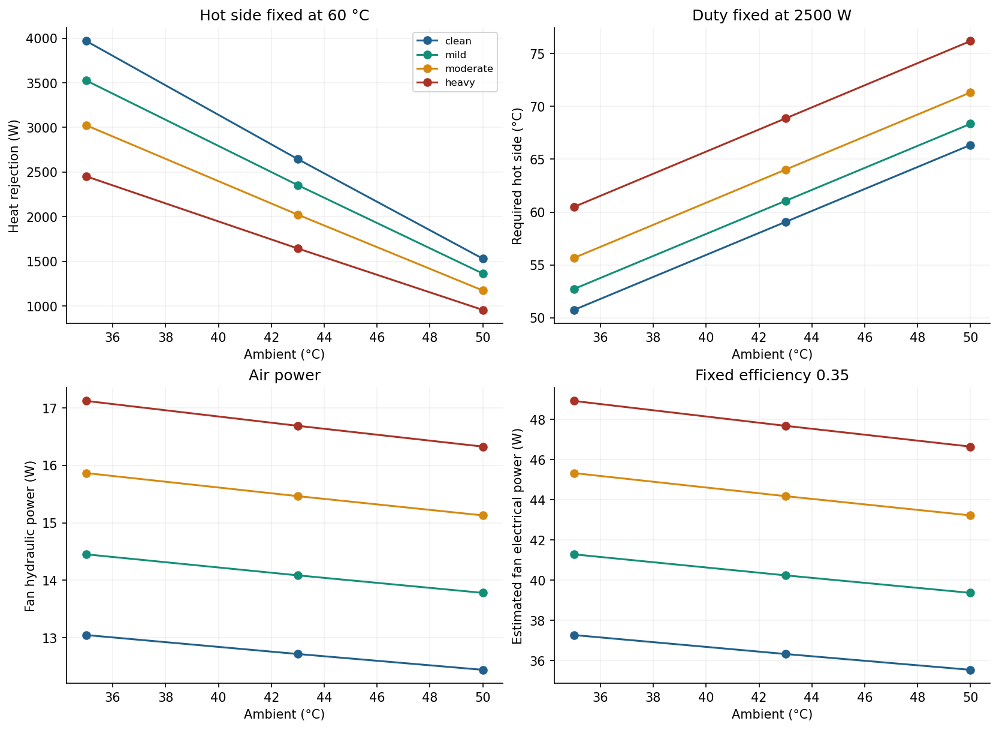
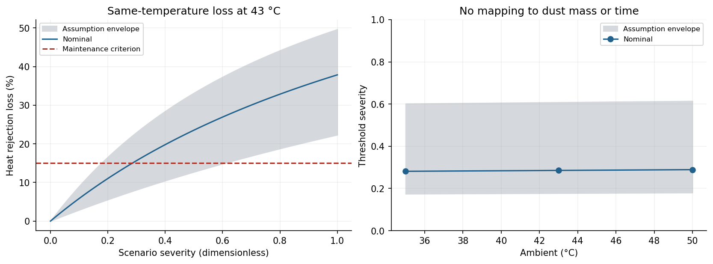

# DustGuard — Condenser Fouling & Thermal Performance Analysis

A coupled fan/system and heat-transfer model examining how assumed air-side fouling changes condenser airflow, heat rejection, and fan power at 35, 43, and 50°C ambient.

## Engineering question

Increased core resistance moves a fan's operating point; deposited material can also add thermal resistance. How much does each mechanism affect heat rejection, and how sensitive is a maintenance criterion to uncertain inputs?

This study solves the fan/system intersection numerically, calculates an effective UA and isothermal-hot-side effectiveness, then compares four fouling scenarios. It includes seven one-at-a-time sensitivities and a 16-corner assumption study. All equipment and fouling parameters are illustrative inputs, not measurements.



## Main results

At **43°C ambient**, the heat comparison fixes the hot side at **60°C**. The required-temperature calculation separately fixes duty at **2500 W**.

| Scenario | Severity | Airflow (L/s) | Core pressure drop (Pa) | Effective UA (W/K) | Heat rejection (W) | Required hot side (°C) | Estimated fan power (W) |
|---|---:|---:|---:|---:|---:|---:|---:|
| Clean | 0.0 | 241.7 | 46.8 | 231.1 | 2645 | 59.1 | 36.3 |
| Mild | 0.2 | 231.2 | 55.6 | 197.8 | 2354 | 61.1 | 40.2 |
| Moderate | 0.5 | 217.6 | 66.3 | 163.0 | 2023 | 64.0 | 44.2 |
| Heavy | 1.0 | 199.6 | 79.6 | 126.6 | 1644 | 68.9 | 47.7 |

The heavy scenario predicts **17.5% less airflow** and **37.9% less heat rejection** than clean. Fan electrical power increases along the chosen operating range despite declining airflow; that result depends on the assumed fan curve and fixed efficiency.

A **15% heat-loss criterion** is reached at nominal severity **0.286** at 43°C. The sampled endpoint assumptions move this crossing to **0.177–0.609**. This is an assumption envelope, not a confidence interval or a cleaning schedule. Severity has no calibrated relationship to dust mass or time.



See the [computed report](results/report.md), [12-case comparison](results/scenario_comparison.csv), [mechanism separation](results/mechanisms.csv), and [sensitivity results](results/sensitivity.csv). CSV and JSON retain numerical precision; displayed values are rounded.

## Method

- Ideal dry-air density changes with ambient temperature. A parabolic total-pressure fan curve intersects quadratic core and duct losses, solved with SciPy's bracketed root finder.
- Fouling severity $s$ changes core resistance by $1+as$. The clean UA scales with mass flow as $(\dot m/\dot m_{ref})^n$.
- A lumped thermal resistance $R_f=bs$ is added once: $UA_{eff}=[1/UA_{flow}+R_f]^{-1}$.
- With an isothermal hot side, $\varepsilon=1-\exp[-UA_{eff}/(\dot m c_p)]$ and heat rejection is $\varepsilon\dot m c_p(T_h-T_a)$.
- A separate inverse calculation finds the hot-side temperature needed for the specified duty. Pressure-only, thermal-only, and combined scenarios distinguish the mechanisms.

The [method and verification](docs/method.md) derive the equations and limits. The [assumptions register](docs/assumptions.md) lists every baseline input, uncertainty range, and possible measurement needed for calibration.

## Install and reproduce

Python 3.11 or later is required. Run from the repository root:

```bash
python3 -m venv .venv
source .venv/bin/activate
python -m pip install -e '.[dev]'
dustguard
python -m pytest -q
ruff check .
ruff format --check .
```

`dustguard` regenerates the 12-case comparison, mechanism split, sensitivity tables, maintenance thresholds, report, and six figures in `results/`.

Use a modified JSON file without editing the model:

```bash
dustguard --config configs/baseline.json --output /tmp/dustguard-results
```

Tested locally with Python 3.12.7, NumPy 1.26.4, SciPy 1.13.1, Matplotlib 3.9.2, and Pytest 9.0.3. Ruff is pinned to 0.17.3. Dependencies allow newer compatible releases; plot pixels may differ between library versions.

## Verification and scope

**17 tests pass**, including an independent closed-form operating-point check, an integrated thermal energy ODE, pressure and sensible-energy balances, effectiveness limits, monotonic fouling response, inverse duty calculation, and maintenance-threshold residuals. These verify the numerical model; no physical measurements have been collected.

Both pressure curves scale equally with inlet density, so volume flow is temperature-independent under this model while mass flow and performance change. The whole-UA flow scaling assumes air-side-dominated resistance. Fan efficiency is fixed. Spatial blockage, dust deposition kinetics, humidity, refrigerant desuperheating/subcooling, detailed fin behavior, and a refrigeration cycle are omitted. No whole-appliance COP, ISEER, operating-cost savings, or universal maintenance interval is claimed.

CAD is omitted because geometry is not resolved by this lumped model. A future validation experiment would need measured fan maps, core pressure drops, air temperatures, mass flow, and electrical power; see the [measurement plan](docs/assumptions.md#possible-physical-validation).

## Repository

| Path | Contents |
|---|---|
| `src/dustguard/model.py` | Physical equations, operating-point solve, and maintenance criterion |
| `src/dustguard/study.py` | Configurable comparisons, sensitivities, figures, and report |
| `configs/baseline.json` | Complete assumed inputs and sensitivity ranges |
| `tests/` | Numerical and physical-limit verification |
| `results/` | Reproducible CSV/JSON results, report, and plots |
| `docs/` | Derivation, assumptions, limitations, and physical-validation plan |

MIT licensed. Method references are linked in the engineering documentation.
